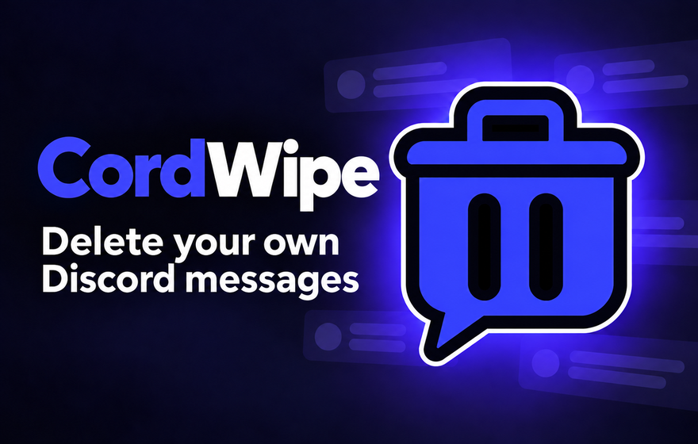

# CordWipe

  

**Delete your own Discord messages in bulk.** Free, open source, and based on [Undiscord](https://github.com/victornpb/undiscord).

Use CordWipe in Discord's web app to clear messages from DMs, group DMs, channels, or servers. Choose what to delete, apply filters if you want, and confirm before anything is removed.

## Install

### Chrome or Edge — browser extension

No Tampermonkey or Violentmonkey needed.

1. **[Download the public preview ZIP — v0.1.0-dev.7](https://github.com/avizmarlon/cordwipe/releases/download/v0.1.0-dev.7/cordwipe-extension-v0.1.0-dev.7.zip)** and extract it. No GitHub login is needed.
2. Open `chrome://extensions` (or `edge://extensions` in Edge).
3. Turn on **Developer mode**, choose **Load unpacked**, and select the extracted folder containing `manifest.json`.
4. Open [Discord in your browser](https://discord.com/channels/@me).

The extension is currently distributed through [GitHub Releases](https://github.com/avizmarlon/cordwipe/releases). To update it, download the newer ZIP, replace the extracted files, and reload the extension and Discord page.

**Public preview:** `0.1.0-dev.7` (Manifest V3 version `0.1.0.7`), including the approved CordWipe branding, filters and confirmation preview described below.

### Userscript — Firefox, Chrome, Edge, and others

1. Install [Violentmonkey](https://violentmonkey.github.io/) or [Tampermonkey](https://www.tampermonkey.net/).
2. **[Install CordWipe on Greasy Fork](https://greasyfork.org/en/scripts/600774-cordwipe)** and confirm in your userscript manager. You can also [install directly from GitHub](https://raw.githubusercontent.com/avizmarlon/cordwipe/main/cordwipe.user.js).
3. Open [Discord in your browser](https://discord.com/channels/@me).

Disable other Undiscord/CordWipe scripts or extensions to avoid duplicate buttons.

## How to use

1. Open the DM or channel you want to clean and click the **trash icon**.
2. Click **me** to read your account ID, then **current** for the server or channel. You can also enter IDs manually. To search a whole server, leave the channel field empty.
3. Optionally filter by text, regex, attachments, links, pinned messages, or date/message range.
4. Click **Find & review** to use your Discord session to search the selected scope. Check the preview and confirm deletion. Nothing is deleted before confirmation.

CordWipe deletes **only messages from your signed-in account**. It supports one channel, multiple channels, or a whole server, and shows progress as it works. **Stop** cancels further work; a request already sent may still complete.

## Good to know

- **Deleting messages is permanent.** Review the selected channel and filters before confirming.
- Discord prohibits automating normal user accounts, which may put your account at risk. [See Discord's policy](https://support.discord.com/hc/en-us/articles/115002192352-Automated-User-Accounts-Self-Bots).
- Works in the **Discord web app**, not the desktop app. Discord updates may affect compatibility.
- The extension requires Chrome/Edge 111 or later. It is not yet available in an extension store.
- Server searches depend on Discord's search index and can miss messages. Only ordinary messages and replies are supported; pinned messages are excluded unless selected.
- Use simple, trusted regular expressions. Complex patterns can freeze the page; a literal text filter is safer when it fits your search.

CordWipe processes session authorization and messages locally and sends requests only to Discord. It has no analytics or backend. Opening the panel does not retrieve authorization or message history; **Find & review** retrieves authorization only after validating your inputs. There is no token field or extra session checkbox. It shares Discord's page environment, so other page scripts can interfere with it. Never copy or share your token. Read the [privacy policy](PRIVACY.md) before use.

Found a bug or have an idea? [Open an issue](https://github.com/avizmarlon/cordwipe/issues).

## Credits and license

CordWipe is based on **[Undiscord](https://github.com/victornpb/undiscord)** by [victornpb](https://github.com/victornpb) and its contributors.

Licensed under [MIT](LICENSE), with the original authors' copyright and attribution preserved.

Want to contribute? See [CONTRIBUTING.md](CONTRIBUTING.md). Developers can also [build the extension from source](docs/extension.md).
